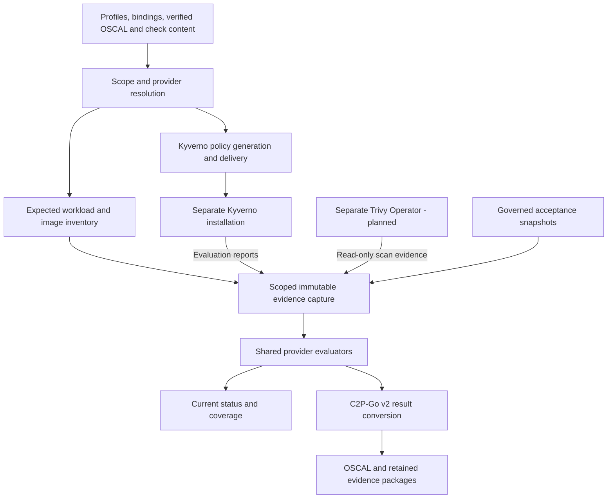

# Konstapel architecture

Status: architecture direction with implementation in progress. The repository
contains the Kyverno integration prototype, controller/API, and continuous
assessment work; see the [targeting API](docs/integration/targeting-api.md) and
[assessment workflows](docs/integration/assessment-workflows.md) for implemented
behavior. Trivy integration described below is planned in
[add-trivy-vulnerability-assessment](openspec/changes/add-trivy-vulnerability-assessment/proposal.md).
The project purpose is in [vision.md](vision.md).

## Direction

Konstapel is a compliance controller written in Go, targeting NIST SP 800-53
and built on **OSCAL Compass compliance-to-policy-go v2 (C2P-Go v2)**.
The initial target is Linux workloads in Kubernetes and NIST SP 800-53 Revision 5
Moderate. The prototype demonstrates bounded technical AC-6 evidence. Broader
checks remain partial evidence, not whole-control or baseline verdicts. Provider
evaluation and operational metrics are framework neutral; pinned OSCAL content
and authored mappings select the framework.

The runtime is a Kubernetes controller using `controller-runtime`,
with C2P-Go embedded as a library behind a small integration boundary. Konstapel
owns reconciliation, policy delivery, and reporting state. C2P owns the
translation between OSCAL content, policy requirements, and assessment results,
working with installed providers for policy engines and reporting-only checks.

## Inputs and outputs

The workflow needs three kinds of input:

- **Compliance scope:** versioned OSCAL catalog/profile content identifying the
  applicable NIST controls and parameters.
- **Implementation mappings:** OSCAL Component Definitions connecting controls
  to policy rules and checks, using the conventions required by C2P.
- **Check content:** engine-specific policy resources or reporting-only check
  definitions, parameter schemas, and provider compatibility requirements.

The OSCAL catalog supplies requirements. Authored mappings and check content
supply their technical implementation. Content resolution validates pinned
catalog/profile references and provider compatibility. Bundles select supported
installed providers; they cannot install arbitrary executables.

Outputs are reconciled policy resources, current status and coverage information,
and OSCAL Assessment Results linked to the inputs and observations that produced
them.

## Components and flow

| Component | Responsibility |
| --- | --- |
| Konstapel reconciler | Resolve desired scope and input revisions, coordinate work, retry failures, and publish status. |
| C2P integration | Invoke C2P-Go v2 with the selected content and plugin configuration; isolate upstream API changes. |
| C2P provider | Generate policy artifacts or local evaluation plans and convert frozen evidence to provider results. |
| Policy delivery | Apply the intended policies and track which resources Konstapel manages. |
| Policy engine | Evaluate resources and produce native reports; enforce policies when configured to do so. |
| Trivy Operator (planned integration) | Own image scans, scan scheduling, registry credentials, and source reports; remain separately installed. |
| Evidence collector and evaluators | Freeze expected inventory, attribute evidence, preserve freshness and provenance, and evaluate checks and risk disposition. |
| Assessment publishing | Preserve assessment artifacts and their provenance, and expose current coverage and findings. |

These are logical responsibilities, not separate services. Provider integration
reuses the controller manager, scheduling, and publication pipeline.

## C2P-Go v2 integration

The dependency is
`github.com/oscal-compass/compliance-to-policy-go/v2`. Upstream currently develops
v2 on `main` and describes its API as experimental. Implementation should pin a
specific commit through a Go module version and upgrade deliberately.

V2 uses external plugin executables communicating over gRPC through
`hashicorp/go-plugin`. Embedding the Go library therefore also requires packaging
and configuring compatible plugin binaries. C2P manages their lifecycle;
Konstapel must account for plugin failures in reconciliation and status.

The prototype exercises policy generation and result conversion with Kyverno
1.19.2, using a pinned core and a focused provider for modern policies and reports.
Upstream also documents an Open Cluster Management integration.

The planned Trivy provider uses the pinned v2 Configure/Generate/GetResults
interface. Generate produces a local evaluation plan; it creates no Kubernetes
objects. GetResults evaluates a scoped frozen capture using the same evaluator
as current controller status. Kubernetes access remains in the collector, so
offline replay requires neither a running cluster nor an image registry.

## Provider capabilities and scope

Cluster-scoped ComplianceProfile and ComplianceBinding resources live under
`compliance.erenius.io`. Bindings use standard namespace LabelSelectors, with
explicit `{}` selecting all namespaces. Current deployment targets the local
cluster; captures retain cluster and namespace identities for future multicluster
support.

Kyverno performs configured Audit/Deny policy evaluation and enforcement. Planned
Trivy checks use dedicated Audit bindings with independent assessment cadence and
freshness settings. A Kyverno Deny binding can cover the same namespaces. Trivy
Deny or mixed-provider bindings return an explicit resolution error. Trivy does
not create admission policies or Kyverno PolicyException resources.

Provider readiness checks required APIs, supported semantics, and read access.
It remains separate from evidence completeness and assessment outcomes. Engine
enforcement is explicitly not applicable to reporting-only contributions. A
missing Trivy installation must not disable Kyverno-only operation.

## Planned vulnerability assessment

The Trivy adapter reads namespaced VulnerabilityReport evidence for regular and
init containers in Linux workloads. It does not create scan jobs, delete reports
to trigger rescans, or acquire image-registry credentials. Assessment requests
collect evidence; Trivy owns scanning and rescans. Node/control-plane scanning,
Windows support, and vulnerability admission blocking are deferred.

Two checks remain independent:

- **Scan coverage:** every expected image needs attributable, fresh evidence.
  Inventory comes from workload state, so missing reports cannot erase targets.
- **Vulnerability exposure:** evaluate findings against a configurable minimum
  severity, default High (High and Critical), including vulnerabilities without
  an available fix. Preserve original severity, findings, and fix information.

Attribution uses namespace/workload UIDs, container and workload revision, and
immutable image digest. Freshness uses proven source evaluation time and the
binding's maxEvidenceAge (default 2h). Report-update time is not automatically
scan time. Missing, stale, failed, filtered, or unattributable evidence remains
incomplete or unknown; missing scanner/database provenance stays explicit.
Operator versions and configuration must pass compatibility tests before support
is claimed.

Eligible findings reuse authenticated self-service risk acceptance with reason,
bounded expiry, explicit renewal/revocation, and central Forbidden/SelfService
rules. The immutable target includes namespace identity, exact image digest,
vulnerability ID, and affected package. It applies to matching workloads in that
namespace; another digest requires new acceptance. Original findings remain
visible with accepted-risk disposition, and no acceptance can fill a scan gap.

Versioned captures retain provider/check revisions, inventory, source evidence,
provenance limitations, and acceptance snapshots. Namespace projection precedes
export; existing OSCAL/S3 publication and retention handle the result. Initial
RA-5 mappings describe partial technical evidence. Implementation details and
dependency boundaries are in the
[Trivy design](openspec/changes/add-trivy-vulnerability-assessment/design.md).

## Reconciliation behavior

1. Load and validate desired scope, mappings, check content, and provider
   capabilities, recording their revisions.
2. Derive the expected checks from the scoped mappings and identify controls
   without a supported implementation.
3. Generate and reconcile engine policies where applicable; reporting-only
   contributions resolve checks without creating engine resources. Repeating the
   operation with unchanged inputs should converge without unnecessary writes.
4. Freeze expected inventory and collect evidence attributable to the relevant
   checks, resource/image state, and revisions. Results can arrive after policy
   delivery or an independently scheduled scan.
5. Produce assessment results and publish coverage, findings, and freshness.
6. Reconcile again when inputs or reports change, and periodically to detect
   drift or stale evidence.

Policy application success and assessment outcomes must be reported separately.
Missing, stale, skipped, or errored evaluations must remain distinguishable from
passing checks. Changes in scope must not make old evidence appear current.
Policy deletion and replacement require an explicit ownership model.

## Detailed contracts and remaining work

Decided behavior lives in the [targeting specification](openspec/specs/compliance-targeting/spec.md)
and [continuous assessment specification](openspec/specs/continuous-assessments/spec.md).
Other production work remains tracked in [active OpenSpec changes](openspec/changes),
including exception governance, S3 publishing, signed OCI bundles, and Helm
distribution. Planning artifacts describe intended behavior; implementation and
required acceptance tests establish support.

Trivy's first implementation step is a focused compatibility investigation of
digest correlation, source scan times, filtering, and provenance. Deterministic
fixtures and real-operator acceptance must establish those semantics. Its isolated
CI acceptance group will run alongside existing groups and verify collection,
exceptions, export, and offline replay.

## Upstream references

Reviewed at commit `45bfc1a8947e8b56b7e11391e13f8c1f2136cfaa`:

- [C2P-Go overview and v2 status](https://github.com/oscal-compass/compliance-to-policy-go/blob/45bfc1a8947e8b56b7e11391e13f8c1f2136cfaa/README.md)
- [V2 plugin interfaces and packaging](https://github.com/oscal-compass/compliance-to-policy-go/blob/45bfc1a8947e8b56b7e11391e13f8c1f2136cfaa/plugin/README.md)

The Go module pins this revision as
`v2.0.0-rc.1.0.20260824132548-45bfc1a8947e`; upgrades are deliberate.
