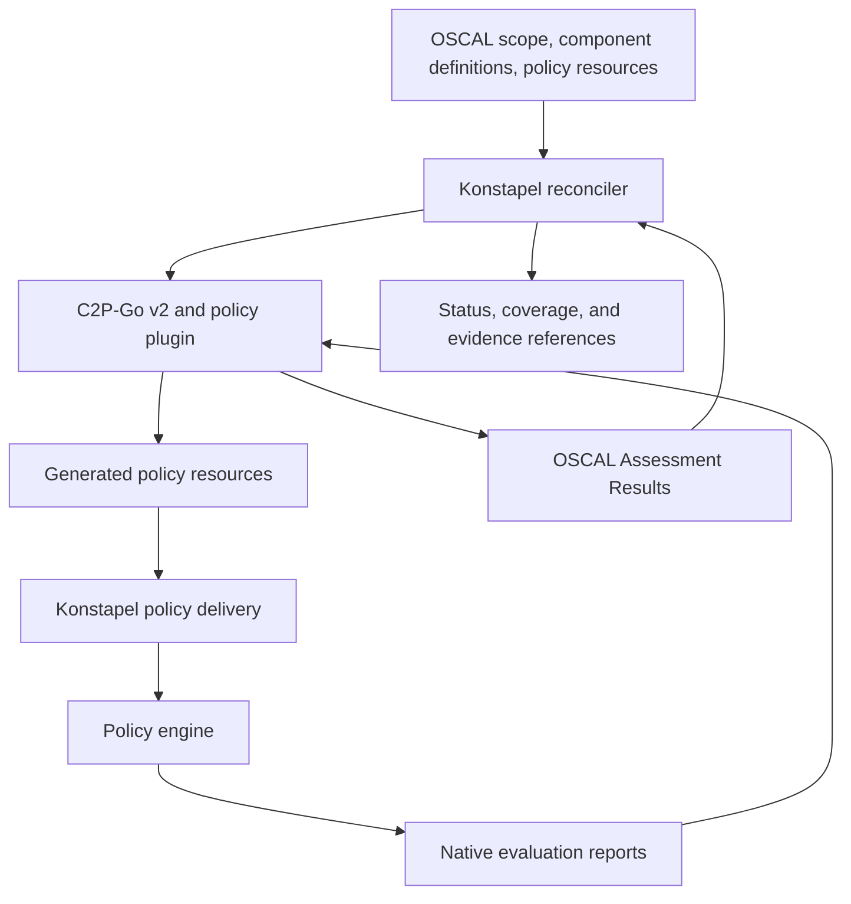

# Konstapel architecture

Status: architecture direction, with the first integration prototype implemented.
The Go runner proves modern Kyverno policy delivery and bounded AC-6 assessment;
see [the acceptance workflow](docs/integration/assessment-loop.md). The production controller and
public Kubernetes API remain future work. The project purpose is in [vision.md](vision.md).

## Direction

Konstapel is a compliance controller written in Go, targeting NIST SP 800-53
and built on **OSCAL Compass compliance-to-policy-go v2 (C2P-Go v2)**.
Kubernetes and NIST SP 800-53 Revision 5 are the working assumptions from the
vision. The prototype uses Moderate baseline content and a bounded technical
check for AC-6; broader assessable control coverage remains future work.

The proposed runtime is a Kubernetes controller using `controller-runtime`,
with C2P-Go embedded as a library behind a small integration boundary. Konstapel
owns reconciliation, policy delivery, and reporting state. C2P owns the
translation between OSCAL content, policy requirements, and assessment results,
working with plugins for the selected policy engine.

## Inputs and outputs

The workflow needs three kinds of input:

- **Compliance scope:** versioned OSCAL catalog/profile content identifying the
  applicable NIST controls and parameters.
- **Implementation mappings:** OSCAL Component Definitions connecting controls
  to policy rules and checks, using the conventions required by C2P.
- **Policy resources:** the engine-specific policies and configuration needed
  to implement those checks.

The NIST catalog supplies requirements. Authored mappings and policy resources
supply their technical implementation. Profile resolution and compatibility
with the selected NIST content must be validated during the first prototype.

Outputs are reconciled policy resources, current status and coverage information,
and OSCAL Assessment Results linked to the inputs and observations that produced
them.

## Components and flow

| Component | Responsibility |
| --- | --- |
| Konstapel reconciler | Resolve desired scope and input revisions, coordinate work, retry failures, and publish status. |
| C2P integration | Invoke C2P-Go v2 with the selected content and plugin configuration; isolate upstream API changes. |
| C2P policy plugin | Generate engine-specific policy artifacts and translate native evaluation results. |
| Policy delivery | Apply the intended policies and track which resources Konstapel manages. |
| Policy engine | Evaluate resources and produce native reports; enforce policies when configured to do so. |
| Assessment publishing | Preserve assessment artifacts and their provenance, and expose current coverage and findings. |

These are logical responsibilities. Their division into packages and controllers
will follow the prototype.

## C2P-Go v2 integration

The dependency is
`github.com/oscal-compass/compliance-to-policy-go/v2`. Upstream currently develops
v2 on `main` and describes its API as experimental. Implementation should pin a
specific commit through a Go module version and upgrade deliberately.

V2 uses external plugin executables communicating over gRPC through
`hashicorp/go-plugin`. Embedding the Go library therefore also requires packaging
and configuring compatible plugin binaries. C2P manages their lifecycle;
Konstapel must account for plugin failures in reconciliation and status.

The prototype exercises policy generation and result conversion with Kyverno
1.19.2, using a pinned core and a focused provider for modern policies and reports.
Upstream also documents an Open Cluster Management integration.

## Reconciliation behavior

1. Load and validate the desired scope, mappings, and policy resources, recording
   their revisions.
2. Derive the expected checks from the scoped mappings and identify controls
   without a supported implementation.
3. Generate and reconcile the associated policies. Repeating the operation with
   unchanged inputs should converge without unnecessary writes.
4. Collect evaluation results and associate them with the relevant policies,
   resources, and input revisions. Results may arrive after policy delivery.
5. Produce assessment results and publish coverage, findings, and freshness.
6. Reconcile again when inputs or reports change, and periodically to detect
   drift or stale evidence.

Policy application success and assessment outcomes must be reported separately.
Missing, stale, skipped, or errored evaluations must remain distinguishable from
passing checks. Changes in scope must not make old evidence appear current.
Policy deletion and replacement require an explicit ownership model.

## Production decisions still open

- Initial NIST baseline, control subset, and source/version of OSCAL content.
- First policy engine, supported versions, and audit/enforcement behavior.
- Kubernetes API and CRD design, including scope and input references.
- Policy ownership, conflicts with existing resources, and cleanup behavior.
- Evidence storage, retention, freshness rules, and access to assessment artifacts.
- Initial deployment scope: one cluster or multiple clusters.

The first implementation milestone is a small, complete loop: selected controls,
authored mappings, generated policies, observed results, and traceable OSCAL
Assessment Results. That experiment should resolve the integration details before
the public API is fixed.

## Upstream references

Reviewed at commit `45bfc1a8947e8b56b7e11391e13f8c1f2136cfaa`:

- [C2P-Go overview and v2 status](https://github.com/oscal-compass/compliance-to-policy-go/blob/45bfc1a8947e8b56b7e11391e13f8c1f2136cfaa/README.md)
- [V2 plugin interfaces and packaging](https://github.com/oscal-compass/compliance-to-policy-go/blob/45bfc1a8947e8b56b7e11391e13f8c1f2136cfaa/plugin/README.md)

The Go module pins this revision as
`v2.0.0-rc.1.0.20260824132548-45bfc1a8947e`; upgrades are deliberate.
