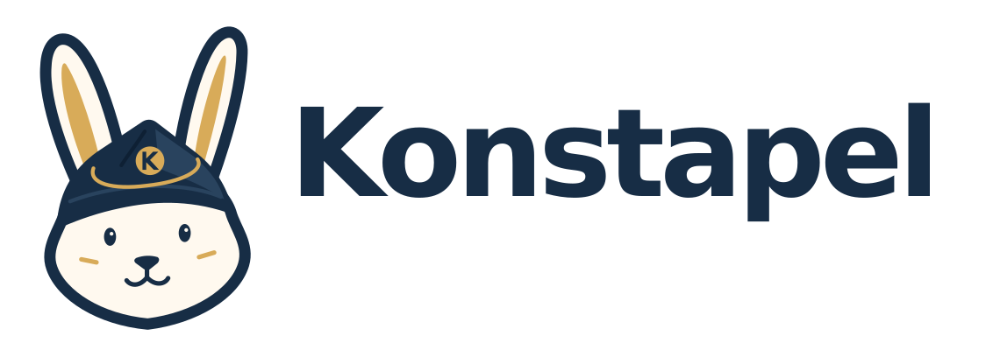

# Konstapel

<p align="center">
  <picture>
    <source media="(prefers-color-scheme: dark)" srcset="docs/assets/branding/konstapel-logo-dark.png">
    
  </picture>
</p>

Konstapel is a compliance controller being built in Go for Kubernetes, targeting
**NIST SP 800-53 Revision 5**. It builds on OSCAL Compass's
[compliance-to-policy-go v2](https://github.com/oscal-compass/compliance-to-policy-go)
to connect compliance requirements, technical policies, and assessment evidence.

> [!NOTE]
> Konstapel is developed using [OpenSpec](openspec/) for requirements, design,
> and implementation planning. All original project code is written by large
> language models (LLMs) under human direction. Vendored upstream content and
> dependencies retain their original authorship and licenses.

The name **Konstapel** is Swedish for **constable**, a traditional title for a
police officer. It reflects the project's role in coordinating policy enforcement
and collecting traceable compliance evidence.

The intended workflow is to:

1. Define the applicable controls through OSCAL content and authored
   control-to-check mappings.
2. Reconcile policies for supported engines and resolve reporting-only checks.
3. Collect attributable evidence and produce traceable OSCAL Assessment Results.
4. Report coverage, findings, and missing or stale evidence as systems change.

## Project status

Konstapel is under active development with an alpha Kubernetes API under
`compliance.erenius.io/v1alpha1`. The controller supports centrally managed
profiles/bindings, namespace targeting, Kyverno policy delivery, continuous and
on-demand assessments, scoped OSCAL evidence, and S3-compatible publishing,
downloads, and retention. The initial framework is NIST SP 800-53 Rev. 5 Moderate;
technical checks provide partial control evidence.

Kyverno is installed separately and performs Audit/Deny enforcement through
`policies.kyverno.io/v1`. The Linux hardening bundle extends the original
privileged-container check, with further assessment integration in progress.
Native self-service exceptions remain disabled pending the documented
[engine compatibility gates](docs/integration/policy-exceptions.md).

Konstapel installs with two Helm charts, distributed as signed OCI artifacts
alongside a signed, digest-pinned controller image. The CRD chart is installed
first and keeps its CRDs on uninstall. The runtime chart runs two controller
and two download-server replicas. See [Helm charts](docs/charts.md) and, for
exactly what the first early-adopter release (v0.1.0) ships, is tested
against, and leaves out, the [v0.1.0 readiness](docs/release-readiness.md)
checklist.

[Trivy vulnerability assessment](openspec/changes/add-trivy-vulnerability-assessment/proposal.md)
is planned: read-only scanner evidence through C2P, dedicated Audit bindings, and
separate scan-coverage and vulnerability-exposure checks. Vulnerability admission
blocking is deferred. Signed OCI policy bundles, evidence signing and metrics
are tracked in [active OpenSpec changes](openspec/changes).

## Documentation

Start with the [documentation index](docs/README.md) for implemented workflows,
in-progress capabilities, and historical validation records.

- [Helm charts](docs/charts.md): installation, TLS modes, values, upgrades and
  uninstall.
- [v0.1.0 readiness](docs/release-readiness.md): what ships, the test behind each
  claim, and known limitations.
- [Development](docs/development.md): Devbox/direnv setup, Task commands, CI,
  and dependency updates with Renovate.
- [Images](docs/images.md): melange/apko builds, SBOMs, signatures, provenance,
  and license notices.
- [Releases](docs/releases.md): release-please version PRs, changelogs and image tags.
- [Vision](vision.md): purpose, principles, and what success looks like.
- [Architecture](ARCHITECTURE.md): components, reconciliation flow, provider
  boundaries, and planned Trivy integration.
- [Targeting API](docs/integration/targeting-api.md): profiles, bindings,
  namespace scope, controller setup, and Kyverno delivery.
- [Assessment workflows](docs/integration/assessment-workflows.md): schedules,
  team requests, results, and scoped evidence downloads.
- [S3 evidence](docs/integration/s3-evidence.md): destinations, credentials,
  publication, retention, retirement, and orphaning.

## Assessment-loop prototype

The Go prototype delivers the shipped Kyverno v1 privileged-container check and
exports bounded AC-6 evidence through C2P v2. See the
[setup, acceptance and evidence guide](docs/integration/assessment-loop.md) and
[recorded validation results](docs/integration/validation-results.md).

## Development quick start

```sh
devbox install
direnv allow
task check
```

With direnv's shell hook installed, `.envrc` activates the pinned Devbox tools.
Alternatively run `devbox run -- task check` without direnv. Use `task --list`
to discover the build, test, policy, and disposable-cluster acceptance commands.

Konstapel's own code is licensed under [Apache-2.0](LICENSE). See [NOTICE](NOTICE)
for attribution; bundled content and dependencies retain their own licenses.
